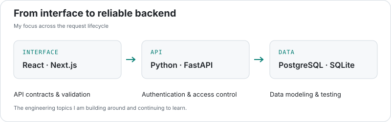
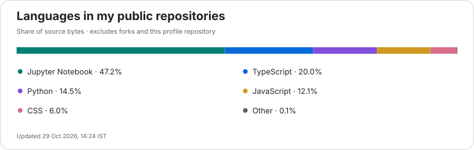

<picture>
  <source media="(prefers-color-scheme: dark)" srcset="assets/header-dark.svg" />
  
</picture>

<p align="center">
  <a href="https://www.linkedin.com/in/rishabhpal19/"></a>
  <a href="mailto:palrishabh989@gmail.com"></a>
</p>

<p align="center">
  <a href="#about-me">About</a> · <a href="#tech-stack">Stack</a> · <a href="#featured-projects">Projects</a> · <a href="#backend-focus">Backend</a> · <a href="#competitive-programming">Competitive programming</a> · <a href="#contribution-stats">Contribution stats</a>
</p>

## About me

Hi, I'm **Rishabh Pal** 

I build full-stack web applications, with a particular interest in **Python and FastAPI backends**. I enjoy connecting useful interfaces to APIs and databases, and working through algorithmic problems alongside development.

```python
developer = {
    "name": "Rishabh Pal",
    "focus": ["Full-stack development", "FastAPI backends"],
    "interests": ["API design", "Data modeling", "Competitive programming"],
    "coding_as": {"leetcode": "risbhh19", "codeforces": "Sensi__", "codechef": "risbh_cf"},
}
```

## Tech stack

<p align="center">
  <picture>
    <source media="(prefers-color-scheme: dark)" srcset="https://skillicons.dev/icons?i=python,fastapi,ts,react,nextjs,tailwind,postgres,sqlite,prisma&amp;theme=dark&amp;perline=9" />
    
  </picture>
</p>

| Backend | Frontend | Data |
| :--- | :--- | :--- |
| Python · FastAPI · REST APIs | TypeScript · React · Next.js · Tailwind CSS | PostgreSQL · SQLite · Prisma · SQLAlchemy |

## Featured projects

### [WaveSafe →](https://github.com/risbh19/waveSafe)

A coastal safety and trip-planning project focused on beach-risk insights and emergency response workflows, using **FastAPI, React and PostgreSQL**. **Private repository.**

### [College Forum →](https://github.com/risbh19/college-forum)

A college discussion platform with topic boards, posts, comments and voting. Built with **Next.js, TypeScript, Prisma and PostgreSQL**, with authentication and ownership checks.

### [Careflow →](https://github.com/risbh19/Careflow)

A fork of [Careflow by arvindkumar-ship-it](https://github.com/arvindkumar-ship-it/Careflow): a hospital workflow prototype using synthetic data, with separate doctor, nurse and patient roles. Combines a **Next.js frontend** with a **FastAPI backend** and server-side access controls.

## Backend focus

<picture>
  <source media="(prefers-color-scheme: dark)" srcset="assets/backend-dark.svg" />
  
</picture>

<picture>
  <source media="(prefers-color-scheme: dark)" srcset="assets/languages-dark.svg" />
  
</picture>

## Competitive programming

<p align="center">
  <a href="https://leetcode.com/u/risbhh19/"></a>
  <a href="https://codeforces.com/profile/Sensi__"></a>
  <a href="https://www.codechef.com/users/risbh_cf"></a>
</p>

<picture>
  <source media="(prefers-color-scheme: dark)" srcset="assets/coding-dark.svg" />
  
</picture>

## Contributions

<picture>
  <source media="(prefers-color-scheme: dark)" srcset="assets/contributions-dark.svg" />
  
</picture>

## Contribution stats

<!-- CONTRIBUTION_STATS:START -->
| Metric | Last 7 days | Last 30 days | Calendar window |
| :--- | ---: | ---: | ---: |
| Contributions | 54 | 70 | 100 |
| Active days | 4 | 5 | 10 |
| Most contributions in one day | 26 | 26 | 26 |

**Current streak:** 4 days · **Longest streak in the calendar window:** 4 days

<sub>Periods end on 2026-10-20 (UTC). Updated 20 Oct 2026, 17:59 IST.</sub>
<!-- CONTRIBUTION_STATS:END -->

<details>
<summary><b>🌙 After hours — anime &amp; retro corner</b></summary>

<br />

<p align="center">
  
</p>

```text
┌─ risbh19@github ──────────────────────────────┐
│ > build useful things                        │
│ > understand the backend                     │
│ > solve the next problem                     │
│                                              │
│ Python / FastAPI / full-stack / algorithms    │
└──────────────────────────────────────────────┘
```

<p align="center"><b>𝙱𝚞𝚒𝚕𝚍. 𝙻𝚎𝚊𝚛𝚗. 𝙸𝚝𝚎𝚛𝚊𝚝𝚎.</b></p>

</details>

---

<p align="center">
  <a href="https://www.linkedin.com/in/rishabhpal19/">LinkedIn</a> · <a href="mailto:palrishabh989@gmail.com">palrishabh989@gmail.com</a> · <a href="https://github.com/risbh19?tab=repositories">All repositories</a>
</p>

<p align="center"><sub>Statistics update hourly; data sections show their observation time. <a href="docs/PROFILE.md">Data &amp; credits</a></sub></p>
