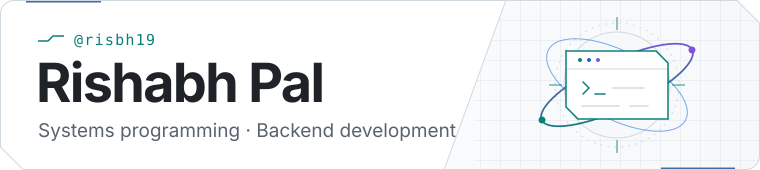
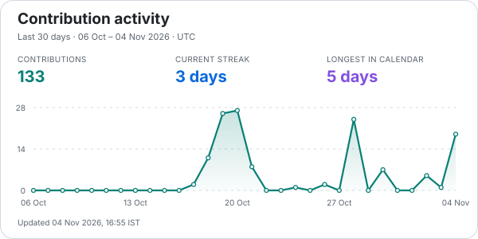
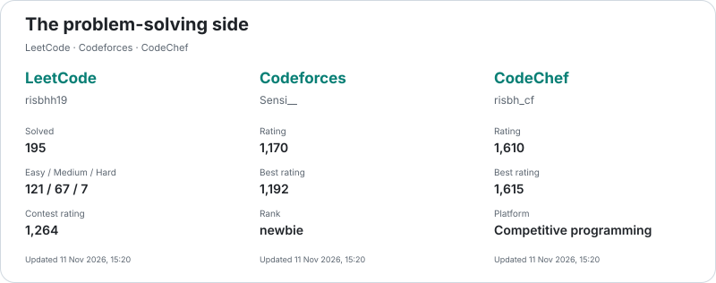

  <picture>
    <source media="(prefers-color-scheme: dark)" srcset="assets/header-dark.svg" />
    
  </picture>
  

    <a href="https://risbh19.xyz">Portfolio</a> ·
    <a href="https://www.linkedin.com/in/rishabhpal19/">LinkedIn</a> ·
    <a href="mailto:palrishabh989@gmail.com">Email</a>
  

## Featured projects

### [mini-redis](https://github.com/risbh19/mini-redis) · `C++17`

A Redis-compatible string store built from scratch with a Linux `epoll` reactor and the RESP2 protocol. It implements TTL, LRU eviction, snapshots and an append-only log.  
[Architecture](https://github.com/risbh19/mini-redis/blob/main/docs/architecture.md) · [Benchmarks](https://github.com/risbh19/mini-redis/blob/main/docs/benchmarks.md)

### [Orbit](https://github.com/risbh19/ide) · `TypeScript` · `Electron`

A desktop IDE with a custom piece-table editor, multi-cursor editing, a TypeScript language server and an integrated terminal.  
[Windows release](https://github.com/risbh19/ide/releases/tag/v0.1.0)

### [Paper Trading Engine](https://github.com/risbh19/trading-bot) · `C++20` · `Python`

A simulator with deterministic market-data replay, simulated fills and pre-trade risk checks. Python research tooling reconciles the trade ledger and evaluates strategy settings on rolling holdout windows.  
[Research methods](https://github.com/risbh19/trading-bot/blob/main/docs/research.md)

## Tech stack

- **Languages** — `C++` `Python` `TypeScript` `JavaScript` `SQL`
- **Backend and data** — `FastAPI` `REST APIs` `PostgreSQL` `Redis` `MongoDB` `JWT`
- **Frontend and tooling** — `React` `Next.js` `Tailwind CSS` `Electron` `Linux` `Docker` `Git` `Postman`

## Experience

**Software Testing Intern · R-Cube Green Technology LLP** · Remote, 1 month

Tested the AcadShree School ERP with Postman. Validated API responses, ran functional and regression tests, and wrote defect reports with reproduction steps.

## Competitive programming

[LeetCode](https://leetcode.com/u/risbhh19/) · [Codeforces](https://codeforces.com/profile/Sensi__) · [CodeChef](https://www.codechef.com/users/risbh_cf)

Coding and GitHub stats

<picture>
  <source media="(prefers-color-scheme: dark)" srcset="assets/activity-dark.svg" />
  
</picture>

<picture>
  <source media="(prefers-color-scheme: dark)" srcset="assets/coding-dark.svg" />
  
</picture>

<!-- CONTRIBUTION_STATS:START -->
<a href="https://github.com/risbh19">
  <picture>
    <source media="(prefers-color-scheme: dark)" srcset="assets/github-stats-dark.svg" />
    
  </picture>
</a>
<!-- CONTRIBUTION_STATS:END -->

[Data sources and refresh schedule](docs/PROFILE.md)

After hours

Anime, retro aesthetics and one more episode.

  

