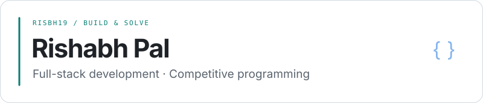
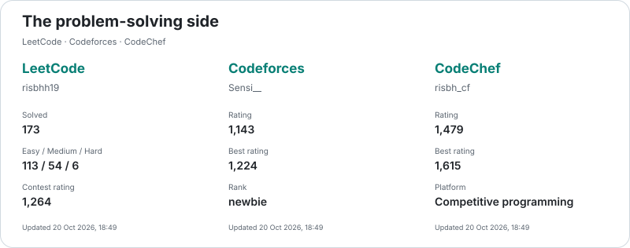
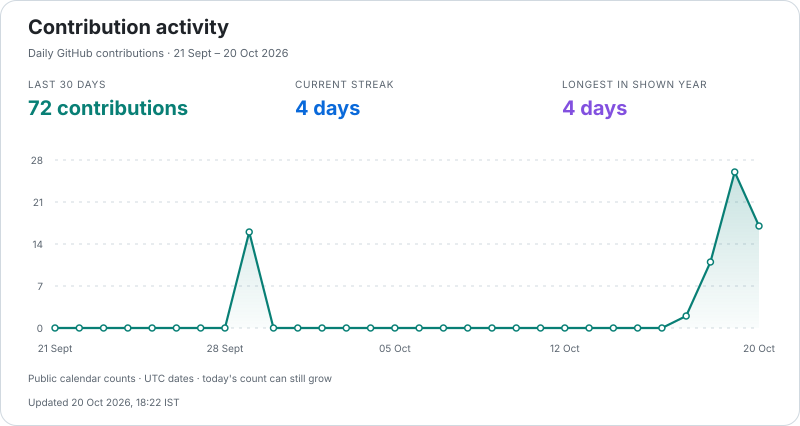
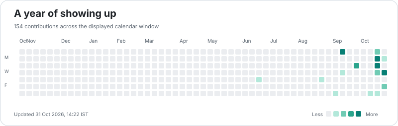

<picture>
  <source media="(prefers-color-scheme: dark)" srcset="assets/header-dark.svg" />
  
</picture>

**3rd-year CSE student at RKGIT**, building full-stack apps with **Python, FastAPI, React and Next.js**. I also practise **competitive programming in C++ and Python**.

[LinkedIn](https://www.linkedin.com/in/rishabhpal19/) · [Email](mailto:palrishabh989@gmail.com) · [Repositories](https://github.com/risbh19?tab=repositories)

## Skills

| Area | Core stack |
| :--- | :--- |
| Languages | Python · C++ · JavaScript · SQL |
| Backend | FastAPI · REST APIs · JWT |
| Frontend | React · Next.js · Tailwind CSS |
| Data | PostgreSQL · MongoDB · Redis |
| Tools | Docker · Git · Postman |

## Featured projects

| Project | Overview |
| :--- | :--- |
| [WaveSafe](https://github.com/risbh19/waveSafe) *(private)* | Coastal safety and SOS workflows · FastAPI, React, PostgreSQL |
| [College Forum](https://github.com/risbh19/college-forum) | Campus discussions, comments and voting · Next.js, Prisma, PostgreSQL |
| [Careflow](https://github.com/risbh19/Careflow) | Hospital workflow prototype with role-based portals · Next.js, FastAPI, MongoDB |

## Experience

**Software Testing Intern · R-Cube Green Technology LLP**  
Remote · **1 month**

Tested AcadShree School ERP using Postman, covering API validation, functional/regression testing and defect reporting.

## Achievements

- **Global Finalist** — Strategy Storm 2026, IIT Guwahati
- **Top 8 Teams** — Investomania 2026, IIT Hyderabad
- **First Runner-Up** — Hackwarts, college hackathon

## Competitive programming

[LeetCode · risbhh19](https://leetcode.com/u/risbhh19/) · [Codeforces · Sensi__](https://codeforces.com/profile/Sensi__) · [CodeChef · risbh_cf](https://www.codechef.com/users/risbh_cf)

Platform statistics

 

<picture>
  <source media="(prefers-color-scheme: dark)" srcset="assets/coding-dark.svg" />
  
</picture>

## GitHub stats

<!-- CONTRIBUTION_STATS:START -->
<a href="https://github.com/risbh19">
  <picture>
    <source media="(prefers-color-scheme: dark)" srcset="assets/github-stats-dark.svg" />
    
  </picture>
</a>
<!-- CONTRIBUTION_STATS:END -->

<a href="https://github.com/risbh19?tab=overview">
  <picture>
    <source media="(prefers-color-scheme: dark)" srcset="assets/activity-dark.svg" />
    
  </picture>
</a>

Full contribution calendar

 

<picture>
  <source media="(prefers-color-scheme: dark)" srcset="assets/contributions-dark.svg" />
  
</picture>

Stats refresh every 24 hours · <a href="docs/PROFILE.md">Data &amp; credits</a>
