  

<h1 align="center">Hey, I'm Rishabh.</h1>
<h3 align="center">Backend Engineering · Systems Programming</h3>

  <picture>
    <source media="(prefers-color-scheme: dark)" srcset="https://readme-typing-svg.demolab.com?font=JetBrains+Mono&amp;weight=500&amp;size=18&amp;pause=1600&amp;center=true&amp;vCenter=true&amp;width=540&amp;height=40&amp;lines=Building+backends.+Understanding+systems.;One+more+edge+case.+Then+we+ship.&amp;color=C9D1D9" />
    
  </picture>

<i>Computer Science undergraduate · RKGIT, Ghaziabad · India</i>

---

<h2 align="center">About Me</h2>

I'm Rishabh, a Computer Science student who likes understanding what happens beneath the interface.

I build backend applications with **Python, FastAPI and PostgreSQL**, and explore networking, storage and data structures through **C++ systems projects**. My projects cover a Redis-compatible server, campus discussions, hackathon team formation and clinic operations.

Currently focused on **database transactions, concurrency, authentication and real-time updates**, alongside data structures and algorithms in C++. Open to **software engineering internships** where I can build and learn.

<h2 align="center">Connect</h2>

  
  &nbsp;&nbsp;
  
  &nbsp;&nbsp;
  
  &nbsp;&nbsp;
  

  
  &nbsp;&nbsp;&nbsp;
  

---

<h2 align="center">Tools &amp; Skills</h2>

  
  
  
  
  
  

  
  
  
  
  
  

  
  
  
  
  
  

<h2 align="center">Featured Projects</h2>

| Project | Description |
| --- | --- |
| [mini-redis](https://github.com/risbh19/mini-redis) | A Redis-compatible C++ key-value server with `epoll`, RESP2, TTL/LRU eviction and persistence. |
| [College Forum](https://github.com/risbh19/college-forum) | A campus discussion platform with Google sign-in, pseudonymous profiles, posts, voting and moderation. |
| [RaceSafe](https://github.com/risbh19/racesafe) | Hackathon team formation with concurrency-safe seat allocation, expiring invites and live updates. |
| [NextUp](https://github.com/risbh19/NextUp) | A clinic operations demo with transactional bookings, waitlists, live queues and patient/staff portals. |

<h2 align="center">GitHub Stats</h2>

<!-- CONTRIBUTION_STATS:START -->
<!-- On-demand refresh requested 2026-11-24; removed automatically after regeneration. -->
<a href="https://github.com/risbh19" title="Rishabh Pal (@risbh19)">
  <picture>
    <source media="(prefers-color-scheme: dark)" srcset="https://raw.githubusercontent.com/risbh19/risbh19/main/assets/github-stats-dark-c80102d8696e7d7b.svg" />
    
  </picture>
</a>
 
Last refreshed: 23 Nov 2026, 06:39 IST · Scheduled every 10 hours · <a href="https://github.com/risbh19/risbh19/actions/workflows/profile.yml">Refresh status</a>
<!-- CONTRIBUTION_STATS:END -->

---

<i>One more edge case. Then one more episode.</i>

Backend systems, C++, anime and retro aesthetics.

